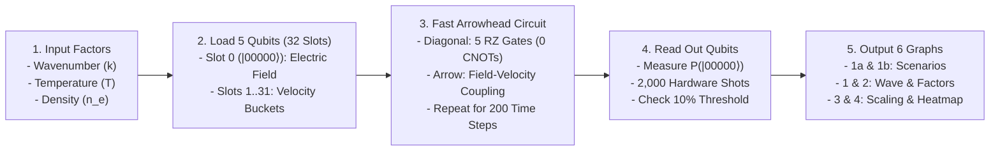

# Tokamak Plasma Wave Simulation: Quantum Circuit vs. Conventional Computer (`gemini_imp`)

A beginner-friendly, modular **Quantum (Qiskit)** vs. **Conventional (SciPy)** plasma wave simulation built so anyone—**with zero physics or quantum computing background**—can immediately see:
1. **What the problem is** (keeping a nuclear fusion reactor stable).
2. **What the quantum circuit is doing** (taking physical factors $\rightarrow$ encoding them into qubits $\rightarrow$ evolving them with quantum gates $\rightarrow$ reading out probabilities $\rightarrow$ graphing the wave).
3. **Whether a quantum computer is genuinely better than a regular computer** (comparing memory compression, hardware-independent operation counts, our **Fast Arrowhead Circuit** optimization, and a **10% Energy Threshold Heatmap** that avoids the quantum readout bottleneck).

---

## Quick Navigation

- [1. What Is the Problem? (Plain-English Physics)](#1-what-is-the-problem-plain-english-physics)
- [2. What Is the Quantum Circuit Doing? (Input Factors $\rightarrow$ Qubits $\rightarrow$ Output Graphs)](#2-what-is-the-quantum-circuit-doing-input-factors--qubits--output-graphs)
- [3. Is the Quantum Circuit Actually Better Than a Regular Computer?](#3-is-the-quantum-circuit-actually-better-than-a-regular-computer)
- [4. Complete Guide to All 6 Generated Graphs (What Each Graph Explains & Why We Need It)](#4-complete-guide-to-all-6-generated-graphs-what-each-graph-explains--why-we-need-it)
- [5. File Map & Code Walkthrough (Sections 1–5)](#5-file-map--code-walkthrough-sections-15)
  - [Section 1: Physical Factors & Scenarios (`config.py`)](#section-1-physical-factors--scenarios-configpy)
  - [Section 2: Encoding Physics into Qubits & the Arrowhead Matrix (`hamiltonian.py`)](#section-2-encoding-physics-into-qubits--the-arrowhead-matrix-hamiltonianpy)
  - [Section 3: Running the Quantum Circuit vs. Classical Algorithm (`simulation.py`)](#section-3-running-the-quantum-circuit-vs-classical-algorithm-simulationpy)
  - [Section 4: Measuring How Fast the Wave Fades & the 10% Threshold (`analysis.py`)](#section-4-measuring-how-fast-the-wave-fades--the-10-threshold-analysispy)
  - [Section 5: Graphing the Results (`plotting.py`)](#section-5-graphing-the-results-plottingpy)
- [6. How to Run](#6-how-to-run)
- [7. Plain-English Glossary](#7-plain-english-glossary)

---

## 1. What Is the Problem? (Plain-English Physics)

In a **tokamak** nuclear fusion reactor, we trap super-hot charged gas (**plasma**) inside a magnetic bottle at over 100 million degrees. Because electrons are negatively charged, whenever a crowd of electrons bunches up in one spot, they push each other apart via an **electric field**, overshoot like a stretched spring, and slosh back and forth. This sloshing is a **plasma wave** (an electric ripple).

When a ripple forms inside a fusion reactor, one of two things happens:
- **Dangerous Case (Instability):** The ripple grows larger and throws hot plasma into the reactor walls, shutting down fusion.
- **Safe Case (Landau Damping):** The ripple naturally fades away on its own, *even when electrons never collide with each other*.

### Why Does the Wave Fade Without Collisions? (The Surfer Analogy)
Imagine ocean waves and surfers paddling at different speeds:
- A surfer moving **slightly slower** than a wave gets caught and pushed forward—**stealing energy from the wave**.
- A surfer moving **slightly faster** than a wave pushes against the back of the wave—**giving energy to the wave**.
- In a warm plasma, electron speeds follow a **bell curve** (many slow electrons, fewer fast ones). That means at the wave's speed, there are always **more slightly-slower electrons than slightly-faster ones**. Net result: the electrons absorb the wave's electric field energy, and the ripple fades away (**Landau damping**).

---

## 2. What Is the Quantum Circuit Doing? (Input Factors $\rightarrow$ Qubits $\rightarrow$ Output Graphs)



### Step-by-Step Pipeline:
1. **Takes 3 Physical Factors (`config.py`):**
   - **Wavenumber ($k$):** How tightly packed the wave crests are ($k = 2\pi / \text{wavelength}$). Higher $k$ = shorter wave = more electrons can surf it = **fades faster**.
   - **Temperature ($T$):** How hot/fast the electrons are. Higher $T$ = wider bell curve of speeds = more fast electrons available to steal wave energy = **fades faster**.
   - **Density ($n_e$):** How tightly packed the electrons are (controls how fast the electric field and electrons push each other).
2. **Stores the Plasma in 5 Qubits (`hamiltonian.py`):**
   - While 5 regular bits can only hold *one* number from `0` to `31` at a time, **5 qubits** in superposition hold **$2^5 = 32$ complex numbers simultaneously**:
     - **Slot `0` (binary `|00000⟩`):** Holds the wave's **Electric Field ($E$)**.
     - **Slots `1` to `31` (`|00001⟩` to `|11111⟩`):** Hold **31 electron velocity buckets** evenly spaced from `-6` to `+6`.
3. **Computes Time Evolution Using Our Fast Arrowhead Circuit (`simulation.py`):**
   - Physics rules say that in each small time step ($\Delta t = 0.1$), two things happen:
     1. **Electrons coast at their own speed** (diagonal of the matrix $H$).
     2. **The electric field and electrons push each other** (top row and left column of $H$, making an **"arrowhead" matrix**).
   - Our quantum circuit applies those two rules 200 times (`n_steps = 200`) using quantum gates (`RZ` rotations and `CNOT` entangling gates).
4. **Reads Out the Answer & Graphs It (`analysis.py` & `plotting.py`):**
   - When you measure the qubits at the end of a run, the probability of all 5 qubits reading zero (`00000`) equals $|\text{state}[0]|^2$, which is the **Electric Field Energy** of the wave!
   - Running the circuit **2,000 times ("shots")** and counting how often `00000` appears gives the realistic hardware measurement.
   - Tracking the peaks of that energy over time gives the **damping rate** (how fast the wave fades) and tells a reactor controller whether the wave drops below **10% of its starting energy** in time.

---

## 3. Is the Quantum Circuit Actually Better Than a Regular Computer?

To answer the research question honestly and scientifically, we solved two major benchmarking problems in `simulation.py`:

### Fix 1 (Problem 2): Fair Hardware-Independent Efficiency Comparison
Why can't you just compare Python runtime (`time.perf_counter()`) between Qiskit and SciPy on a laptop? Because **your laptop is a classical CPU pretending to be a quantum computer**! Simulating qubits on a regular CPU takes exponentially more work than running on real quantum hardware.
- **How we fixed it:** Instead of comparing laptop wall-clock seconds, `simulation.py` counts **hardware-independent operations**:
  - **Conventional Computer Cost:** Uses a **sparse matrix (`scipy.sparse.csr_matrix`)**—which skips all the zeros in the arrowhead matrix just like a real high-performance classical solver—and counts exact **Floating-Point Operations (`FLOPs`)** performed by the Runge-Kutta (`RK45`) solver.
  - **Quantum Computer Cost:** Compiles the circuit into real superconducting hardware gates (`cx`, `rz`, `sx`, `x`), counts **2-Qubit `CNOT` Gates** and **Sequential Circuit Depth**, and estimates real **Quantum Processor (QPU) execution time** (at ~50 nanoseconds per gate layer).

### Fix 2 (Problem 3): The Fast Arrowhead Quantum Circuit (Up to 13.7× Fewer CNOT Gates!)
Originally, converting the $2^n \times 2^n$ Hamiltonian matrix $H$ into quantum gates using Qiskit's generic `SparsePauliOp.from_operator(H)` treated $H$ like a dense block of numbers. That required $\sim 4^n$ CNOT gates per step (`2,516` CNOTs/step at 5 qubits; `9,882` CNOTs/step at 6 qubits!), which would ruin any quantum advantage.
- **How we fixed it (`build_fast_arrowhead_step_circuit` in `simulation.py`):**
  We exploited the **Arrowhead structure** of $H = H_{\text{diag}} + H_{\text{arrow}}$:
  1. **Diagonal Coasting ($H_{\text{diag}}$):** Because velocity $v_j$ is evenly spaced, each qubit $m$ simply rotates by angle $-k \, \Delta v \, 2^m \Delta t$ using **one single-qubit `RZ` gate** (**zero CNOTs** for the velocity ramp!) plus a phase correction on `|00000⟩`.
  2. **Field-Velocity Coupling ($H_{\text{arrow}}$):** Since slot `0` only talks to one combined velocity wave $\lvert\phi\rangle$, evolution happens inside a simple **2D subspace** ($\lvert\psi_+\rangle, \lvert\psi_-\rangle$), requiring only two state-preparation reflections per step instead of $4^n$ Pauli strings.

| Qubits ($n$) | Velocity Buckets | Old Naive Pauli CNOTs/Step | **New Fast Arrowhead CNOTs/Step** | **Gate Reduction** | Classical Sparse Solver Work |
|---:|---:|---:|---:|---:|---:|
| **3 qubits** | 7 | 124 | **52** | **2.4× fewer** | 317,376 FLOPs |
| **4 qubits** | 15 | 598 | **164** | **3.6× fewer** | 732,480 FLOPs |
| **5 qubits** | 31 | 2,516 | **368** | **6.8× fewer** | 1,522,080 FLOPs |
| **6 qubits** | 63 | 9,882 | **720** | **13.7× fewer** | 3,038,496 FLOPs |

### The Final Verdict: When Should You Use a Quantum Computer?
1. **For a 1D Wave (Our 5-Qubit Demo): Regular Computer Wins.**
   In 1D, the state vector only has 32 numbers. A classical sparse solver finishes the entire 200-step simulation in ~1.5 million FLOPs (~2 milliseconds on a laptop), whereas even our optimized quantum circuit needs `368 × 200 = 73,600` CNOT gates across 200 steps.
2. **For a Full 3D Fusion Reactor (`3D3V`): Quantum Computer Has a Massive Memory Advantage.**
   A real tokamak has **3 space axes $(x,y,z)$ + 3 velocity axes $(v_x,v_y,v_z)$ = 6 dimensions**.
   - At a modest grid resolution of $N = 128$ points per axis, a conventional computer must store $128^6 \approx \mathbf{4.4 \times 10^{12}}$ **numbers** (~70 Terabytes of RAM). At $N = 1024$, it needs $10^{18}$ numbers (impossible on any supercomputer).
   - A quantum computer stores the exact same $128^6$ grid in just **$6 \log_2(128) = \mathbf{42\text{ qubits}}$**!

---

## 4. Complete Guide to All 6 Generated Graphs (What Each Graph Explains & Why We Need It)

Running `python gemini_imp/plasma_simulation.py` generates **6 PNG figures** in `gemini_imp/figures/`. Here is a clear, moderate-depth breakdown of what each graph shows, how to read it, and *why* it is needed to answer our research question.

---

### Graph 1A & Graph 1B: `1a_quantum_circuit_scenarios.png` & `1b_classical_algorithm_scenarios.png`
*(Side-by-Side Scenario Comparison: Quantum Circuit vs. Conventional Algorithm)*

- **What these two graphs explain:**
  - **Graph 1A (`1a_quantum_circuit_scenarios.png`)** shows the output of our **5-Qubit Fast Arrowhead Quantum Circuit** across three completely different fusion reactor conditions:
    1. **Scenario A (`k = 0.35, T = 0.8` — Long, Gentle Wave in Cooler Plasma):** Because the wave is stretched out and electrons move more slowly, very few electrons can "surf" the wave to steal its energy. The wave bounces up and down while fading very slowly (`rate = -0.0317`).
    2. **Scenario B (`k = 0.50, T = 1.0` — Baseline Tokamak Ripple):** A typical wave tightness and temperature where Landau damping drains energy at a moderate pace (`rate = -0.1540`).
    3. **Scenario C (`k = 0.65, T = 1.3` — Tight Wave in Hotter Plasma):** Shorter wavelength plus faster electrons means many electrons surf the wave, draining its energy almost immediately (`rate = -0.3683`).
  - **Graph 1B (`1b_classical_algorithm_scenarios.png`)** shows the exact same three scenarios computed by a **Conventional Computer (`scipy.integrate.solve_ivp` Sparse RK45 Solver)** using identical X and Y axes.
- **How to read the curves:**
  - The **Y-axis is logarithmic (`10⁰` down to `10⁻⁴`)** because exponential decay looks like a straight downward line on a log scale.
  - The **bouncing arches** happen because energy sloshes back and forth between the electric field (peaks) and moving electrons (valleys) twice per wave cycle.
  - The **orange dots in Graph 1A** show what a real quantum computer outputs when you run the circuit **2,000 times ("shots")** and count how often `00000` is measured.
- **Why we need these two graphs:**
  - Before asking *"Is the quantum computer faster?"*, we first have to prove **it actually gets the physics right across different environments**. Putting Graph 1A and Graph 1B next to each other lets any viewer see that the 5-qubit quantum circuit faithfully reproduces the conventional differential-equation solver in slow, medium, and fast damping scenarios.

---

### Graph 1: `1_quantum_vs_classical_wave.png`
*(Direct Single-Wave Overlay: Quantum vs. Classical on the Baseline Wave)*

- **What this graph explains:**
  - Places the **Classical Sparse Solver (solid black line)**, the **Quantum 5-Qubit Fast Arrowhead Circuit (blue dashed line)**, the **2,000-Shot Hardware Readout (orange dots)**, and the **Fitted Decay Slope (red dotted line)** on top of one another on a single chart (`k = 0.5, T = 1.0`).
- **Why we need this graph:**
  - While Graphs 1A and 1B let you inspect each method separately across scenarios, overlaying both curves on the exact same axes proves that **the quantum circuit's trajectory lies directly on top of the conventional algorithm's curve** from $t = 0$ to $t = 20$.
  - It also visually demonstrates **shot noise**: when the wave energy drops below `10⁻³` (after $t = 15$), running 2,000 hardware shots means only 1 or 2 shots land on `00000`, explaining why hardware dots quantized at `1/2000 = 0.0005` appear near the bottom right.

---

### Graph 2: `2_factors_affecting_plasma.png`
*(Parameter Sweeps: How Wavenumber $k$ and Temperature $T$ Control Wave Fading)*

- **What this graph explains:**
  - **Left Panel (Factor 1 — Wavenumber $k$ from `0.3` to `0.7`):** Plots the wave fade speed $|\gamma|$ as wave crests become tighter (shorter wavelength). Both the quantum circuit and classical solver show fade speed rising steeply from `~0.015` at $k = 0.3$ to `~0.38` at $k = 0.7$.
  - **Right Panel (Factor 2 — Electron Temperature $T$ from `0.6` to `1.6`):** Plots the wave fade speed as the plasma gets hotter. Higher temperature widens the bell curve of electron speeds, putting more fast electrons near the wave's speed and accelerating damping from `~0.04` to `~0.32`.
- **Why we need this graph:**
  - It directly answers the **first half of our research question** (*"How do various factors affect the movement of plasma in a nuclear fusion reactor?"*). Instead of just looking at raw wave bounces, this graph summarizes 11 full simulations into two clean trend lines that anyone can understand at a glance: **shorter waves ($k \uparrow$) and hotter plasma ($T \uparrow$) both damp ripples faster**.

---

### Graph 4: `4_stability_threshold_heatmap.png`
*(The 10% Wave Energy Threshold Heatmap — Reactor Controller Decision Map)*

- **What this graph explains:**
  - Imagine you are designing the **magnetic feedback controller** for a tokamak reactor. Your magnets take a certain amount of time to react (the **X-axis: Controller Response Time**), and a plasma ripple of a certain wavelength appears (the **Y-axis: Wavenumber $k$**). You want to know one simple yes/no question:
    > *"By the time my magnets can react, has this ripple already faded below **10% of its starting energy** on its own?"*
  - **Colors on the map:**
    - **Red / Orange Zone (Left of the White Line):** The wave still holds **more than 10%** of its starting energy. It has *not* faded yet—**the reactor controller must act**.
    - **White Contour Line:** The exact **10% energy threshold cutoff** ($\text{Energy Left} = 0.10 \times \text{Start Energy}$, or $\log_{10}(\text{ratio}) = -1$).
    - **Green Zone (Right of the White Line):** The wave has naturally damped to **less than 10%** of its initial energy—**safe to ignore; it fades on its own**.
    - **Blank White Cells (Bottom-Right Corner):** Intentionally masked out beyond $0.8 \times t_{\text{revival}}$ (where discrete velocity buckets cause a fake mathematical echo) so artificial grid echoes are never mistaken for real plasma waves.
- **Why we need this graph (Crucial for Quantum Computing!):**
  - One of the biggest traps in quantum computing is the **Readout Bottleneck**: if you use $n$ qubits to simulate $2^n$ numbers and then try to read out *all* $2^n$ numbers at the end, you have to run the circuit $\sim 2^n$ times—destroying your quantum speedup!
  - This heatmap shows how we **bypass the readout bottleneck**: a reactor controller does not need to read out all $2^n$ velocity buckets. It only needs to check **one probability**—$P(\lvert 00000\rangle)$—at 4 sample points across one wave bounce (`4 × 2,000 = 8,000` shots total) to see if the wave crossed the white 10% threshold line. That shot cost stays constant whether you have 5 qubits or 50 qubits!

---

### Graph 3: `3_quantum_vs_classical_scaling.png`
*(3-Panel Viability & Efficiency Benchmark: Memory, Circuit Optimization, and Total Operations)*

- **What this graph explains:**
  - **Panel 1 (Left — 3D Reactor Memory Compression):** Compares how much memory is needed to simulate a full 3D tokamak reactor (`3D3V` = 3 space axes + 3 velocity axes = 6 dimensions) as grid resolution $N$ increases from `8` to `256` points per axis. A regular computer needs **$N^6$ floating-point numbers** (billions to trillions of numbers, tens of Terabytes of RAM), whereas a quantum register needs only **$6 \log_2(N)$ qubits** (`18` to `48` qubits).
  - **Panel 2 (Middle — Problem 3 Fix: CNOT Gate Count per Step):** Compares the number of 2-qubit `CNOT` gates needed per time step for $n = 3, 4, 5, 6$ qubits. The **pink dashed line** is Qiskit's generic dense Pauli decomposition ($\sim 4^n$ scaling, hitting `9,882` CNOTs/step at 6 qubits). The **green solid line** is our **Fast Arrowhead Circuit**, which exploits the arrowhead matrix structure to slash gate counts by **up to 13.7×** (`720` CNOTs/step at 6 qubits).
  - **Panel 3 (Right — Problem 2 Fix: Fair Hardware-Independent Operations):** Compares total operations for a full 200-step 1D run across $n = 3..6$ qubits: **Classical Sparse Solver FLOPs (black)** vs. **Naive Pauli CNOTs (pink)** vs. **Fast Arrowhead CNOTs (blue)**.
- **Why we need this graph:**
  - It directly answers the **second half of our research question** (*"Would it be useful to simulate in a quantum computer vs. a conventional computer?"*) with hard quantitative evidence rather than guesswork:
    1. It proves **why quantum is exciting** for 3D fusion reactors (Panel 1: exponential memory compression from $N^6$ numbers down to $6\log_2 N$ qubits).
    2. It proves **how smart algorithm design makes quantum circuits dramatically more efficient** (Panel 2 & 3: our Fast Arrowhead circuit cuts CNOT gates by up to 13.7×).
    3. It gives an **honest engineering conclusion** (Panel 3): for small 1D problems, a classical computer still wins (~1.5M FLOPs takes ~2 ms on a CPU), whereas 3D reactor problems on future fault-tolerant quantum computers are where quantum advantage becomes real.

---

## 5. File Map & Code Walkthrough (Sections 1–5)

| Step | Python File | What It Owns | Key Functions / Constants |
|---|---|---|---|
| **1** | [`config.py`](config.py) | Physical parameters, 3 tokamak scenarios, velocity grid | `DEFAULT_CONFIG`, `SCENARIOS`, `make_velocity_grid` |
| **2** | [`hamiltonian.py`](hamiltonian.py) | Maxwellian bell curve, Arrowhead matrix $H$, Gauss's law start state | `maxwellian_bell_curve`, `build_hamiltonian_matrix`, `create_initial_qubit_state` |
| **3** | [`simulation.py`](simulation.py) | Fast Arrowhead circuit, Naive Pauli circuit, Sparse RK45 solver, FLOPs/gate benchmarks | `build_fast_arrowhead_step_circuit`, `run_quantum_simulation`, `run_classical_simulation`, `benchmark_efficiency_scaling` |
| **4** | [`analysis.py`](analysis.py) | Peak detection, log-linear damping rate fit, 10% threshold envelope & shot classifier | `measure_damping_rate`, `compute_remaining_energy_envelope`, `classify_reactor_stability` |
| **5** | [`plotting.py`](plotting.py) | Generates all 6 PNG charts in `gemini_imp/figures/` | `plot_separate_scenario_graphs`, `plot_figure_1_quantum_vs_classical`, `plot_figure_2_factors_comparison`, `plot_figure_3_quantum_vs_classical_viability`, `plot_figure_4_stability_heatmap` |
| **6** | [`plasma_simulation.py`](plasma_simulation.py) | Main script that runs Stages 1–5 and prints clear terminal output | `main` |

---

### Section 1: Physical Factors & Scenarios (`config.py`)
- Defines `DEFAULT_CONFIG` (`n_qubits = 5`, `wavenumber = 0.5`, `temperature = 1.0`, `density = 1.0`, `max_velocity = 6.0`, `end_time = 20.0`, `n_steps = 200`).
- Defines `SCENARIOS` (Scenarios A, B, and C) so we can test the quantum circuit and classical solver across slow, moderate, and fast damping conditions.
- `make_velocity_grid(n_qubits, max_velocity)` reserves Slot `0` for the electric field and splits `[-6.0, +6.0]` into $2^n - 1 = 31$ evenly spaced velocity buckets (`dv` is the gap between buckets).

### Section 2: Encoding Physics into Qubits & the Arrowhead Matrix (`hamiltonian.py`)
- **`maxwellian_bell_curve(velocities, temperature)`:** Computes the bell-curve spread of electron speeds:
  $$f_0(v) = \frac{1}{\sqrt{2\pi T}} \exp\left(-\frac{v^2}{2T}\right)$$
- **`build_hamiltonian_matrix(config)`:** Quantum gates can only apply **unitary** updates $\text{new\_state} = \exp(-i H \Delta t)\,\text{old\_state}$ where $H$ is a symmetric (**Hermitian**) matrix. Rescaling the velocity buckets turns the plasma equations into a $32 \times 32$ **Arrowhead Matrix**:
  - **Diagonal `H[j, j] = k * v_j`:** Electrons coasting at velocity $v_j$.
  - **Top Row `H[0, j] = +i * coupling_j`:** Moving electrons generating current that updates the electric field in Slot `0`.
  - **Left Column `H[j, 0] = -i * coupling_j`:** Electric field pushing velocity bucket $j$, where $\text{coupling}_j = \sqrt{n_e}\, v_j \sqrt{f_0(v_j)\,\Delta v}$.
- **`create_initial_qubit_state(config)`:** Builds the starting state at $t=0$ obeying **Gauss's Law** ($E_0 = \frac{i}{k}\sum f_0(v_j)\Delta v$) and divides by `np.linalg.norm` so the squared qubit amplitudes sum to `1.0` (100% probability).

### Section 3: Running the Quantum Circuit vs. Classical Algorithm (`simulation.py`)
- **`build_diagonal_circuit` & `build_arrow_circuit` (Problem 3 Fix):**
  - Instead of decomposing $H$ into $\sim 4^n$ Pauli strings, `build_fast_arrowhead_step_circuit` uses a 2nd-order Suzuki-Trotter split:
    $$\exp(-i H \Delta t) \approx \exp\left(-i H_{\text{diag}} \frac{\Delta t}{2}\right) \exp(-i H_{\text{arrow}} \Delta t) \exp\left(-i H_{\text{diag}} \frac{\Delta t}{2}\right)$$
  - Because $v_j$ is linear in the binary bits of index $j$, $\exp(-i H_{\text{diag}} \Delta t/2)$ takes just **1 single-qubit `RZ` gate per qubit** plus a zero-state phase correction.
  - Because $H_{\text{arrow}}$ only couples Slot `0` to a single collective velocity state $\lvert\phi\rangle$, $\exp(-i H_{\text{arrow}} \Delta t)$ is implemented exactly in the 2D subspace spanned by its two eigenstates $\lvert\psi_\pm\rangle = (\lvert 0\rangle \mp i\lvert\phi\rangle)/\sqrt{2}$.
- **`run_quantum_simulation(config)`:** Prepares the initial state with Qiskit's `StatePreparation`, evolves 200 steps, reads out Slot `0` probability $|\text{state}[0]|^2$, simulates `2,000` hardware measurement shots via a binomial draw, and records transpiled `CNOT` gate counts, circuit depth, and estimated superconducting QPU time.
- **`run_classical_simulation(config)`:** Converts $H$ into a sparse `csr_matrix`, solves $\frac{d(\text{state})}{dt} = -i H \cdot \text{state}$ with `scipy.integrate.solve_ivp` (`RK45`), and computes exact classical floating-point operations (`total_flops = rhs_evaluations * nnz * 8`).

### Section 4: Measuring How Fast the Wave Fades & the 10% Threshold (`analysis.py`)
- **`measure_damping_rate`:** Finds oscillation peaks safely before $0.8 \times t_{\text{revival}}$ ($t_{\text{revival}} = \frac{2\pi}{k \cdot \Delta v}$), fits a straight line to $\ln(\text{Peak Energy})$ vs. time $t$, and divides the slope by `2` (since $\text{Energy} = |E|^2 \propto e^{2\gamma t}$) to get the Landau damping rate $\gamma$.
- **`compute_remaining_energy_envelope`:** Computes the maximum wave energy over a sliding window of width `3.0` plasma ticks (covering at least one wave bounce so an oscillation trough is never mistaken for a damped wave), divided by the starting energy `energy[0]`.
- **`classify_reactor_stability`:** Simulates `2,000` hardware shots at `4` sample times inside the window (`8,000` total shots) to test whether the wave has faded below the `10%` energy threshold.

### Section 5: Graphing the Results (`plotting.py`)
- Generates all 6 figures (`1a`, `1b`, `1`, `2`, `3`, `4`) using Matplotlib's `Agg` backend so it runs cleanly from any terminal without popping up blocking windows.

---

## 6. How to Run

From the repository root:

```bash
# Windows (PowerShell)
python -m venv .venv
.venv\Scripts\activate
pip install -r requirements.txt
python gemini_imp/plasma_simulation.py

# Linux / macOS
python3 -m venv .venv
source .venv/bin/activate
pip install -r requirements.txt
python gemini_imp/plasma_simulation.py
```

---

## 7. Plain-English Glossary

| Term | Plain-English Meaning |
|---|---|
| **Tokamak** | A donut-shaped magnetic bottle used to trap hot plasma for nuclear fusion. |
| **Landau Damping** | When a plasma wave fades away on its own because slightly-slower electrons "surf" the wave and steal its energy—without any particle collisions. |
| **Wavenumber ($k$)** | $2\pi / \text{wavelength}$ — how tightly packed the wave crests are. Higher $k$ = shorter wave = fades faster. |
| **Qubit Superposition** | $n$ qubits hold $2^n$ complex numbers (amplitudes) at once. 5 qubits hold 32 slots (`00000` to `11111`). |
| **Arrowhead Matrix ($H$)** | Our $32 \times 32$ physics matrix that only has numbers on the diagonal (coasting electrons) plus Row 0 and Column 0 (electric field coupling), with zeros everywhere else. |
| **Suzuki-Trotter Step** | Splitting a combined physics update into alternating simpler gate steps ($\text{Diag}(\Delta t/2) \rightarrow \text{Arrow}(\Delta t) \rightarrow \text{Diag}(\Delta t/2)$). |
| **Hardware Shots** | Running the quantum circuit 2,000 times and counting how often `00000` is measured to estimate the wave's electric field energy. |
| **10% Threshold Heatmap** | A decision map showing whether a plasma wave drops below 10% of its starting energy (green = safe) or stays above 10% (red = controller must act) by a given response time. |
| **FLOPs vs. CNOTs** | Fair, hardware-independent ways to count work: Floating-Point Operations (`FLOPs`) on a regular computer vs. 2-qubit entangling gates (`CNOTs`) on a quantum computer. |
